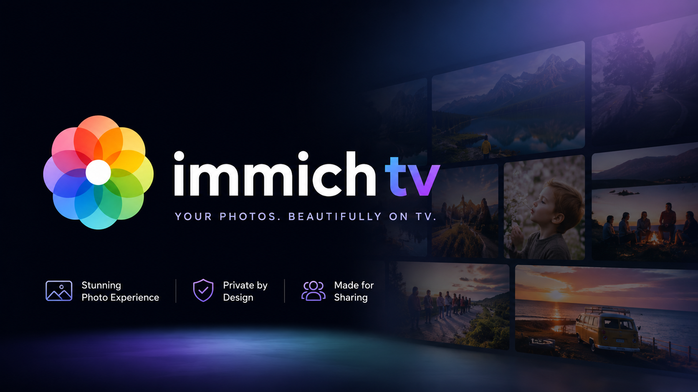

# Immich TV

<p align="center">
  
</p>

**Your self-hosted Immich library, built for the living room.**

Immich TV is a TV-first, read-only client for browsing photos and videos on Android TV and Google TV from the couch. It connects to the Immich server you already run and turns it into a remote-friendly, fullscreen experience — while the same Flutter codebase also builds for web, desktop, and mobile.

## Why Immich TV?

- **Made for a remote, not a mouse.** Large focus states, predictable arrow-key navigation, an on-screen keyboard for setup, and pointer/keyboard support when you have them.
- **Read-only by design.** Browsing and playback only, so a shared household TV never becomes a library-management device.
- **Works with your server, old or new.** Capability detection keeps newer Immich APIs optional instead of required.
- **Survives imperfect networks.** Retries, cached media, and an offline banner keep the experience calm on flaky Wi-Fi.

## Features

### Browse everything, your way

- **Timeline** with a horizontal year rail for instant jumps across large libraries
- **Albums** with a folder rail and a date-grouped asset grid
- **People** with face thumbnails and per-person media
- **Favorites** with sortable, paginated grids
- **Memories** — "On this day" and birthday memories grouped into one folder per year, with photos grouped by date inside
- **Places** — browse photos by city using Immich's map data, with location details in each folder

### Playback that fits the big screen

- **Fullscreen photos and videos** with clean, screen-safe metadata and transport overlays
- **Slideshow** with 5/8/12-second intervals, shuffle, pause/resume, and **continuous playback** that keeps loading the next page as you approach the end of the library
- **Adaptive HLS video** on supported servers, with automatic fallback to transcoded and original sources
- **Wallpaper mode** with a clock overlay for a calm, ambient display

### Details on demand

- Press **`i`** in the viewer for a read-only info panel: description, camera, capture date, location, filename, metadata, and OCR-detected text

### Profiles and privacy

- Save multiple profiles for quick re-entry on shared TVs
- Optional 4-digit PIN with a remote-friendly numeric keypad
- Secrets in platform secure storage; metadata in SharedPreferences
- Password or personal API-key sign-in

### Built for reliability

- **Server capability handshake** at sign-in (`/server/version`, `/server/media-types`, `/config`) so features only appear when the server supports them
- **Bounded retries** for transient read and image failures
- **Offline banner** with manual retry while already-loaded media stays browsable
- **Opt-in performance HUD** with rebuild counters for large-library tuning

## Status

Actively developed and usable as a focused TV browsing client. The current release line is **1.6.0**.

## Server Compatibility

Immich TV probes the server at sign-in and adapts to what it finds. If discovery fails it falls back to a conservative feature set that works on older servers. Memories and Places use their dedicated APIs when available; HLS is an opt-in setting because it is still an Alpha Immich API, and it is limited to native v3+ players with automatic fallback. Streaming sessions are released when playback stops.

## Quick start

Requirements: Flutter SDK and an accessible Immich server (or use demo mode).

```bash
flutter pub get
flutter run
```

Quality checks:

```bash
flutter analyze
flutter test
```

For a profiling build with the performance HUD:

```bash
flutter run --dart-define=immichtv.profile=true
```

## Demo mode

Enter this exact server URL in onboarding:

```text
https://demo.immichtv.local
```

Then sign in with:

```text
Email:    demo@immich.tv
Password: demo1234
```

Demo mode is only triggered by that exact URL and includes sample albums, people, memories, and places.

## Documentation

- [Development checklist and roadmap](docs/DEVELOPMENT_CHECKLIST.md)
- [Android TV packaging guide](docs/ANDROID_TV_PACKAGING.md)
- [Release process and versioning](docs/RELEASING.md)
- [Release notes](docs/RELEASE_NOTES.md)
- [Release and QA checklist](docs/RELEASE_CHECKLIST.md)

## Tech stack

Flutter · Dart 3.11 · flutter_bloc · Dio · video_player · flutter_secure_storage · shared_preferences

## Repository map

- `lib/main.dart` — startup and image cache tuning
- `lib/app.dart` — dependency wiring and theming
- `lib/src/app_shell.dart` — bootstrap → onboarding/profile picker → home
- `lib/src/core` — models, repositories, networking, capability detection, performance
- `lib/src/features` — feature UI, Cubits, and API implementations
- `lib/src/shared` — design tokens and reusable TV widgets
- `lib/src/platform` — platform-aware persistence and media adapters
- `test/` — unit, widget, and integration coverage
- `docs/` — roadmap, packaging, and release documentation

## Roadmap

- Measure scroll smoothness and image memory on real TV hardware
- Browser-side HLS support for platforms without native playback
- Search, "Surprise me", and recently added browsing
- Broader web and desktop validation

## Disclaimer

Immich TV is an independent client project and is not an official Immich app. You must already run or have access to an Immich server to use it.

## License

MIT — see [LICENSE](LICENSE).
